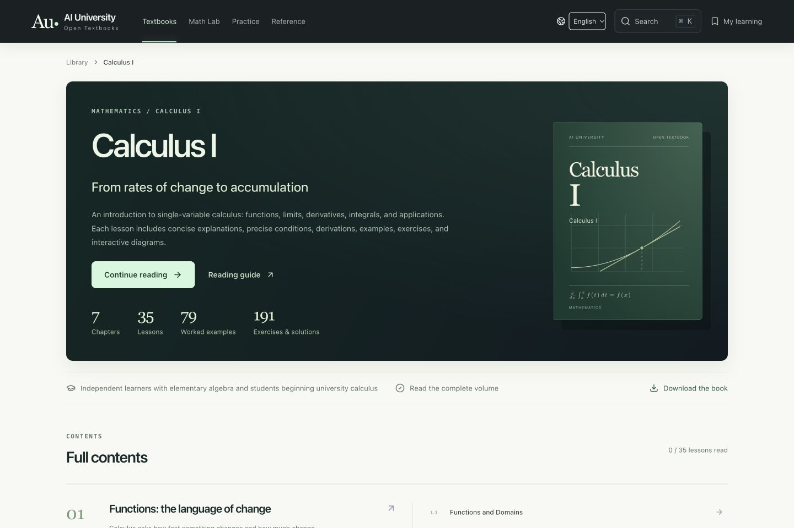

# English Calculus I · v0.18.0

Date: 2026-10-23 (America/Los_Angeles). English edition 1, aligned with Chinese source v0.3.3. AI-authored; `humanReviewed=false`.

## Scope

All 7 chapters and 35 lessons are translated, with 79 worked examples and 191 exercises including chapter reviews and the final assessment. The English edition includes complete solutions, conditions, derivations, misconceptions, visual instructions, 105 guided teaching presets and observations, glossary, proof supplements, and source-use notes. The Chinese canonical content and the other nine textbooks remain available.

English is the default interface and reading language. The language selector preserves the current route and the shared local lesson/exercise records. Chinese-only books carry explicit labels and links rather than partially translated English reading pages. English Markdown and print HTML are generated from the same English collection.

## Verification

- English answer punctuation is normalized, including formula-only answers inherited from the Chinese source.
- Translation fields have complete coverage and matching source SHA-256 checksums.
- Mathematical fragments match their source expressions, allowing translation of prose within TeX text labels and reordering of fragments. IDs, numeric answer keys, correct-choice indices, prerequisites, and diagram presets remain unchanged.
- All English mathematical notation is rendered with the same local KaTeX pipeline. The English notation validator distinguishes English articles and possessives from mathematical symbols; explicit source math remains protected independently.
- Render checks cover every lesson's reading, diagram, practice, and connection view, all chapter and review routes, shared resource pages, English search, and language-availability notices.
- Actual browser checks opened all 35 reading pages and all 70 diagram/practice pages at phone width, with no untranslated text observed apart from the intentional Chinese language selector.
- Actual language-switch testing preserved the derivative lesson, selected diagram view, and a bookmark; the temporary bookmark was removed afterward.
- The derivative animation reached its finite minimum distance and displayed the English completion explanation. Three-dimensional disk controls and their accessible instructions rendered in English.
- Phone layout checks found a book-statistics overflow; the English statistics now use a two-column phone layout. Desktop and phone screenshots and interaction checks accompany local QA.

These checks detect structural, alignment, rendering, and selected interaction problems. They do not prove every mathematical statement, establish educational effectiveness, or constitute human review.

