# 学习体验审查 · 2026-10-26

本次按真实学习任务检查，而非给页面打一个没有测量依据的分数。结论：书库和教材内容已有基础，最大的短板是“没看懂、答错、看完图”之后的继续路径。v0.22.0 优先修正这些衔接；共享组件覆盖中英文八本数学教材的 345 节，编程教材保留自己的执行回放。

证据均为本轮实际页面截图，保存后重新打开检查；未使用旧聊天截图。对照包含不同设备尺寸和任务状态，用于行为审查，不是像素复刻评分。

| 步骤 | 用户任务 | 原状 | 本轮结果 |
|---|---|---|---|
| 1 | 选书并进入章节 | 分类、封面和课程入口清楚 | 保留；未重做首页 |
| 2 | 看不懂时继续理解、跟做例题 | 只有一个替代解释；例题一步展开全部答案 | 增加四种按需讲解路径、逐步例题与回补链接 |
| 3 | 答错概念题 | 立即标出正确选项，缺少重试和学习去向 | 先给本节要点；重试、显式查看答案、进入演示 |
| 4 | 操作模型、理解结果 | 三个参数按钮与图形、结果、练习分离 | 开始引导、当前步骤、图旁任务、观察核对、练习出口 |
| 5 | 做练习、管理自评 | 已有分层提示，但数值反馈泛泛提及单位；没有撤销单题状态入口 | 保留提示；改进反馈，允许只清除本题记录 |
| 6 | 编程执行回放 | 有预测、逐行执行和输出 | 本次抽查运行有效；跨学科导航仍可统一 |

## 1. 书库与学习入口：基本健康

数学分类、八本已出版教材、两列封面与筛选入口易于识别。章节有阅读、演示、练习、知识连接。小屏幕首屏更强调章节标题；后续应观察读者是否能迅速找到所需解释，而不是继续增加首屏文案。

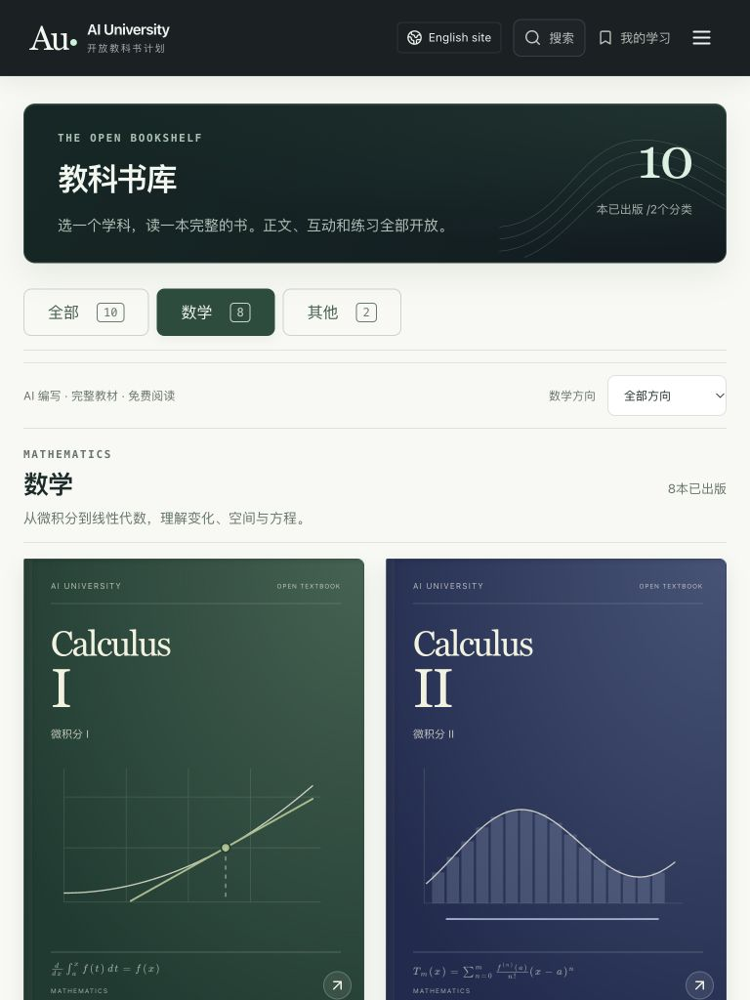
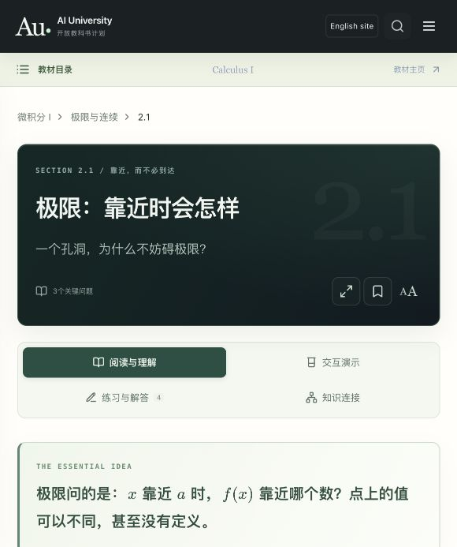

## 2. 按需讲解与例题：已改进

原来的“换个说法”只有一段替代说明，例题只能一次打开完整解法。现在可以选择另一种说明、拆开推导、跟做例题、回看前置知识。所有文字和公式来自同一 learning object，保留定义条件；没有自由文本聊天、运行时模型或假装实时生成。

例题可以一次展开一步、退回、直接看全解，或收起再做。最后一步展开后焦点落到答案，避免当前按钮消失后丢失键盘位置。前置链接打开实际已出版章节。

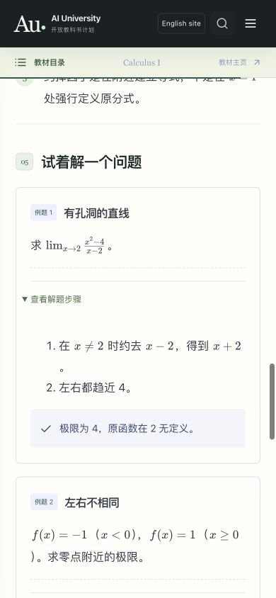
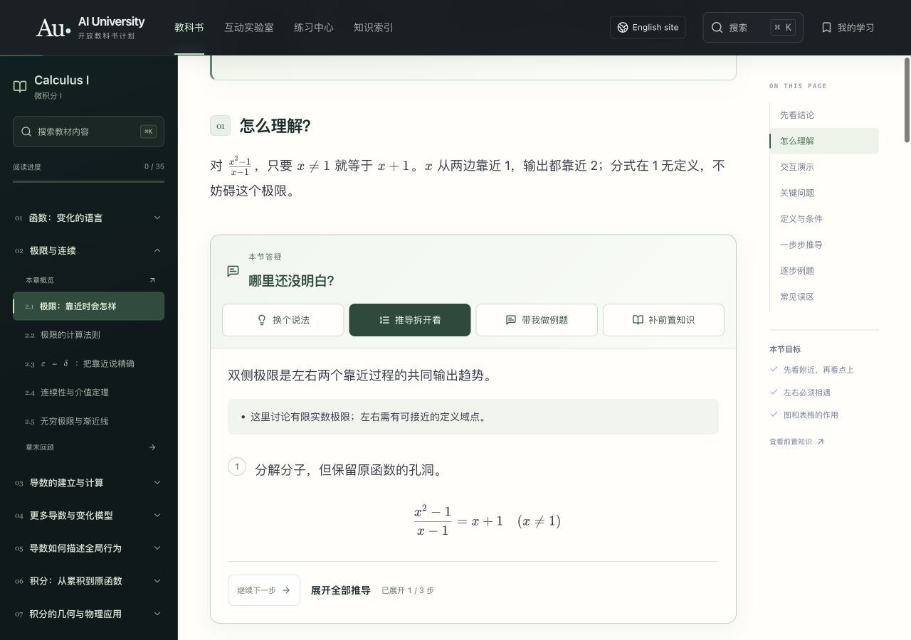
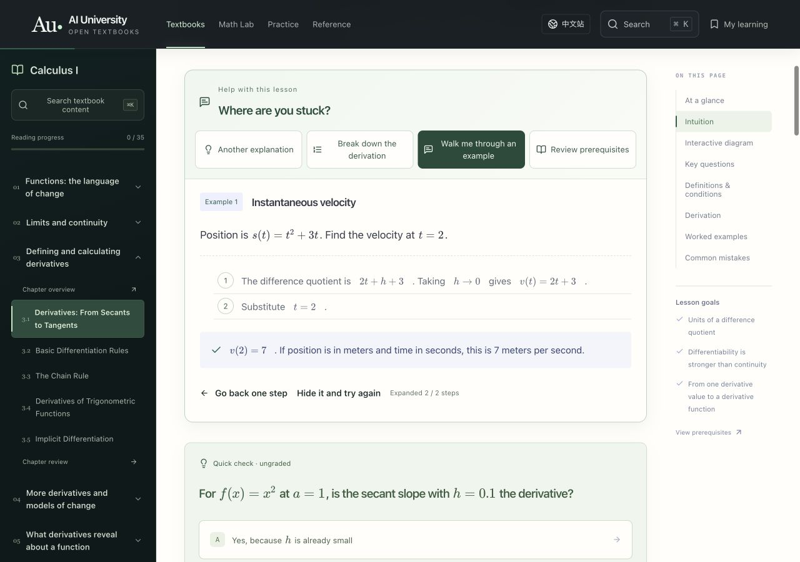

## 3. 概念检查：保留真正的重试机会

原界面在选择错误项后，立即给正确项绿色标记。现在先提供本节的简短解释，不提前标出正确选项；读者可重试、主动查看答案与解释，或转去图中验证。重试将键盘焦点送回原选项。回答正确时仍直接提供解释。

这不是错误原因自动诊断。多数题没有逐选项专属解释，系统使用的是已经写好的本节要点，不能声称理解了读者的思维过程。

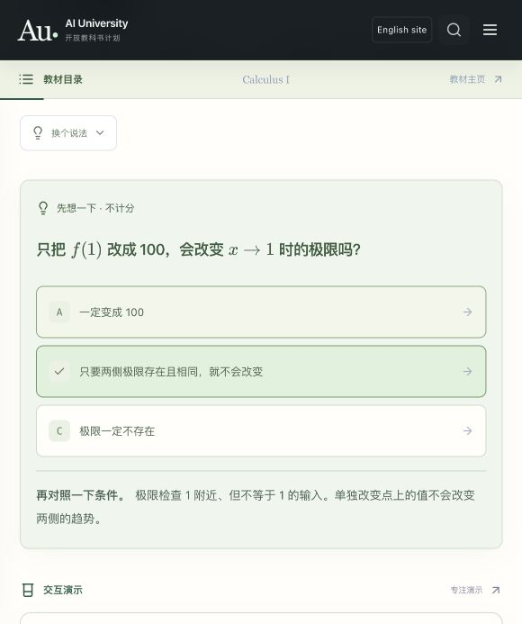
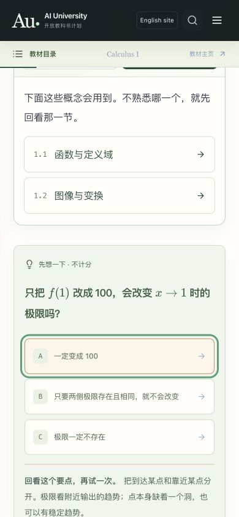

## 4. 数学演示：任务、模型、观察、练习接起来

原来的三个步骤更像跳到不同参数的快捷键，图形常在任务区下方较远处。现在有明确开始入口、当前步骤、聚焦图形操作、图下观察核对和练习出口。宽桌面屏幕把任务固定在模型旁，滚动操作时保留上下文；手机、平板维持单列阅读顺序。

自由改变参数后明确说明观察文字对应预设，可以恢复原参数。没有把固定文字冒充当前图形的自动分析。图形和读数仍来自原有模型，不把有限采样说成证明。

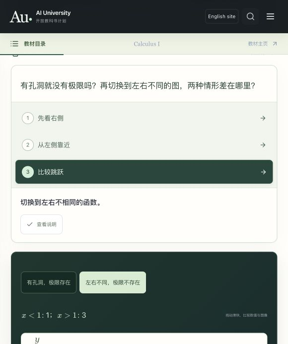
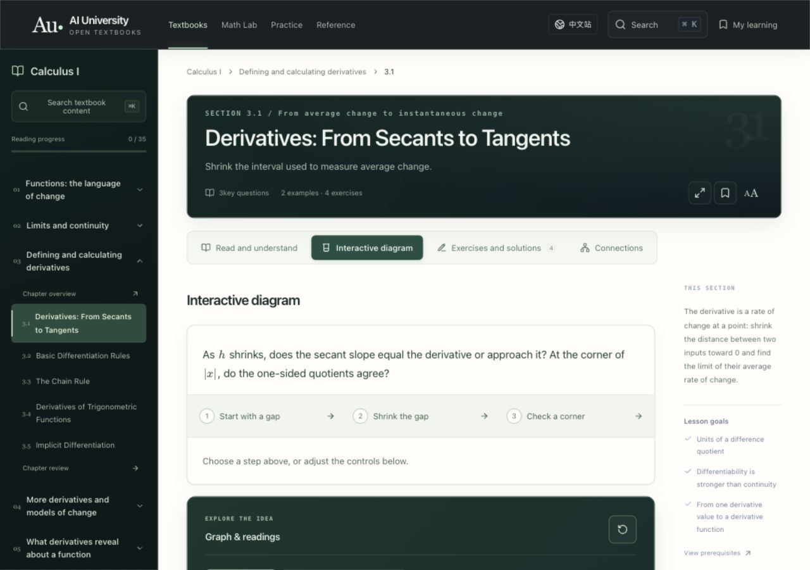
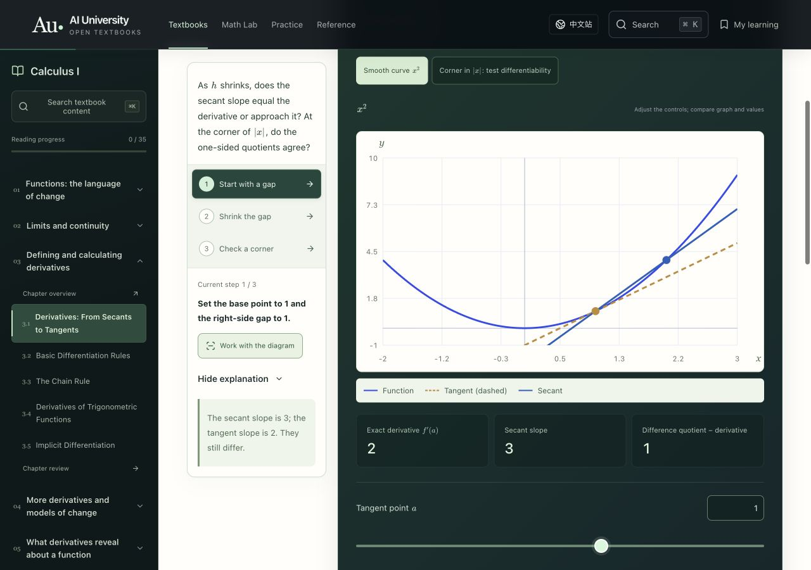
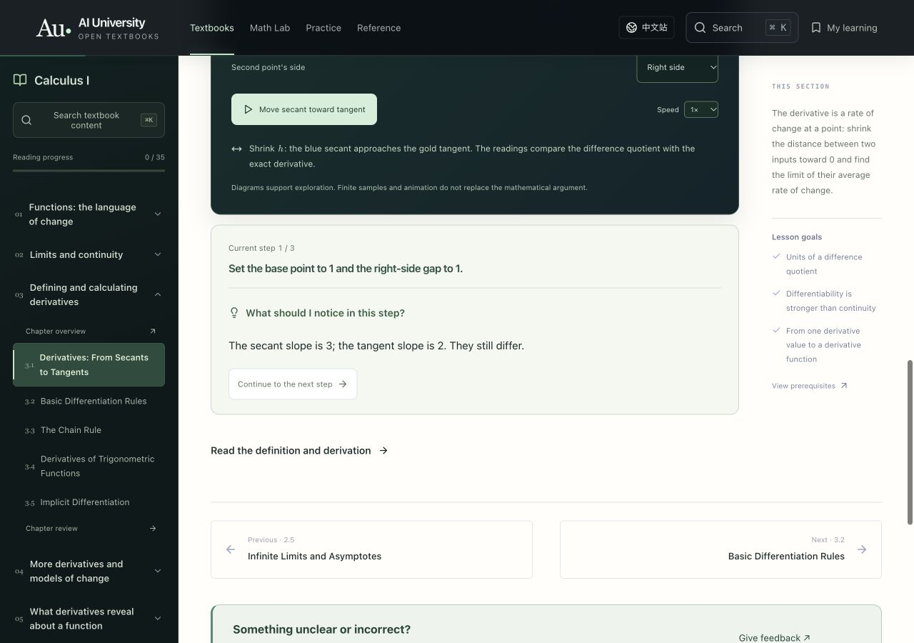

三维模型保留拖动、键盘和投影视角。坐标刻度增大、颜色加深，并加背景描边。实际拖动后没有选中文字。数学模型、范围和解答未变更。

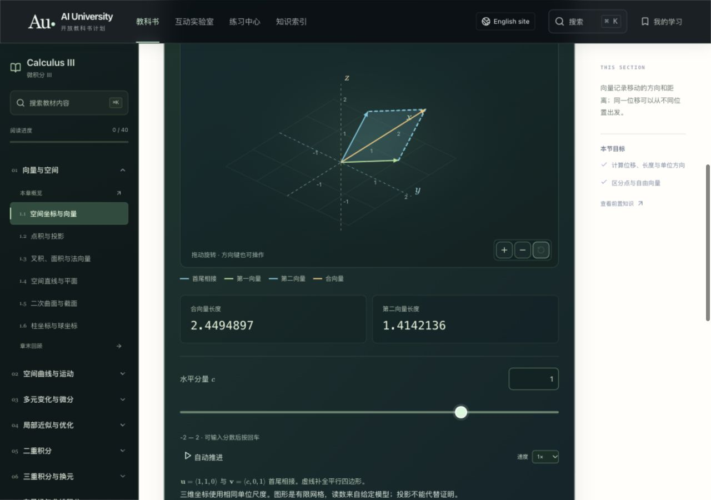
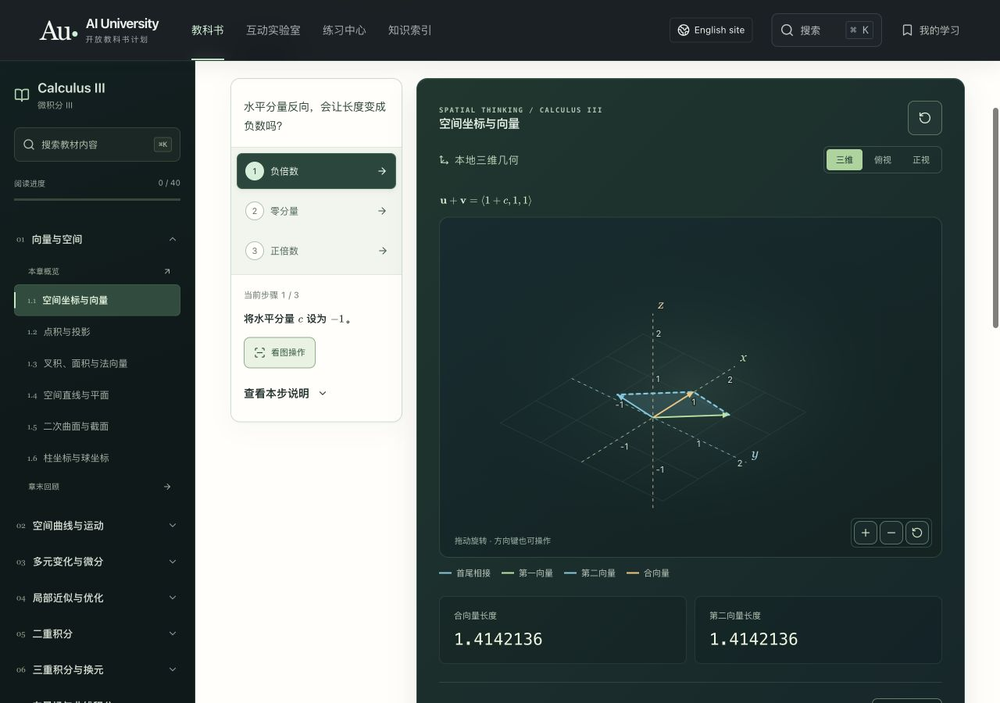

## 5. 练习与记录：保留有效提示，增加撤销入口

分层提示和自评本来已经存在，本轮保留。数值题改为紧凑输入并支持回车检查，推导题保留多行输入。反馈不再无差别要求检查单位，而是按本题提示回看计算。新增的清除按钮只撤销这一题的掌握/回顾状态，保留草稿、其他题目和阅读记录。

在本地实际将两题标记为回顾，只清除第一题，第二题仍保留回顾状态；随后清除临时记录。清除操作后的键盘焦点返回输入区。

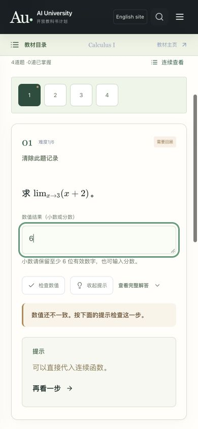

## 6. 编程教材：执行回放有效，导航一致性待继续

抽查 Python 第一节：点击下一步后，当前行、下一行和标准输出随回放变化。预测和实际输出能建立联系。数学与编程使用不同的页头/目录组织，这仍会增加切换学科时的重新识别成本。本轮没有把数学组件硬套到编程教材，也没有声称已统一所有十本教材的教学界面。

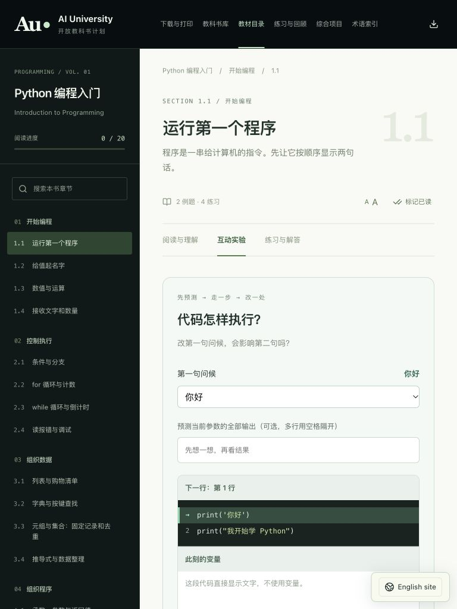

## 验证与限制

- `npm run check` 通过 165 项仓库测试，以及已有代码执行、翻译一致性、内容验证、类型检查与构建；英文整站默认视图持续检查。
- 浏览器实际检查中文极限、英文导数、三维向量，以及 Python 执行回放；新答疑四种状态、逐步/全解、概念题重试与显式揭晓、预设恢复和演示至练习的路径均操作验证。
- 390×844、768×1024、1280×900 检查未发现所查页面横向文档溢出。临时视口覆盖已恢复。
- 新的按钮有明确名称与展开状态，键盘重试/结束/撤销有焦点处理；新动效与滚动尊重减少动态效果偏好。未使用屏幕阅读器完整测试，未证明全站 WCAG 合规。
- 没有逐节人工检查全部 345 节，没有测量学习效果，也没有把小样本截图当作数学正确性证明。

## 接下来最值得做的三件事

1. 为重要误区逐题撰写分选项的定向反馈，并提供与具体误区一致的反例实验；不靠泛化文字伪装诊断。
2. 把复杂章节的“改变什么—观察什么—为何成立”继续逐节深化，并统一编程/数学的回补和返回原问题路径。
3. 邀请读者自愿试学，检查能否独立完成推导和迁移练习；用主动反馈验证效果，不添加隐蔽行为追踪。
