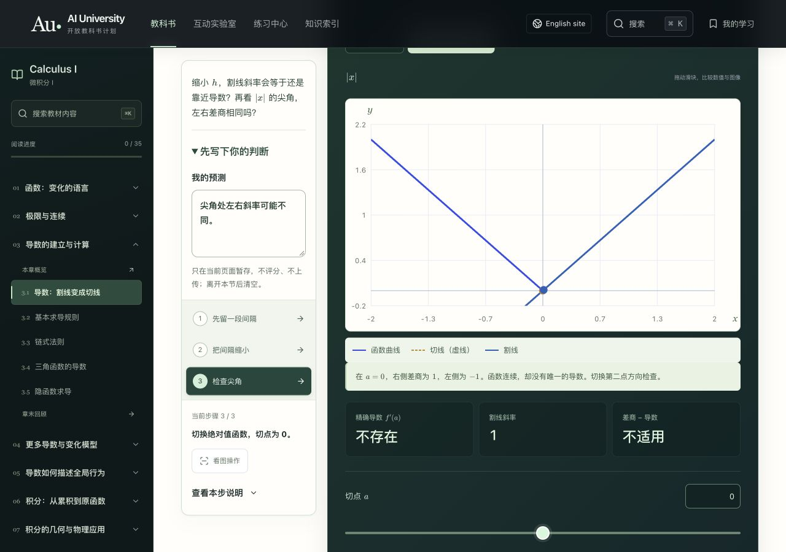
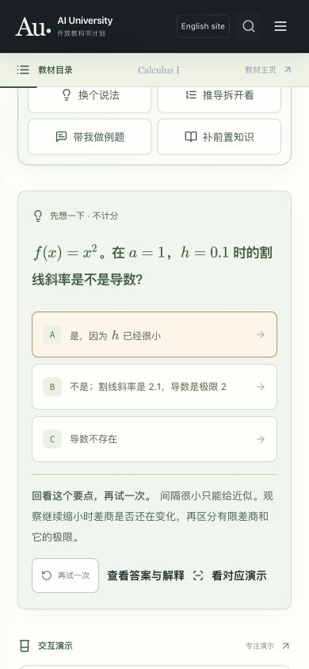
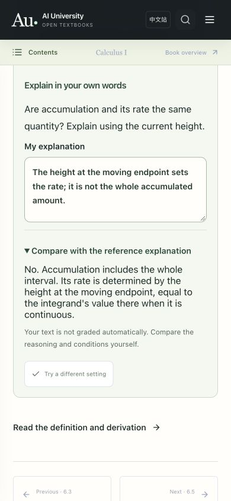
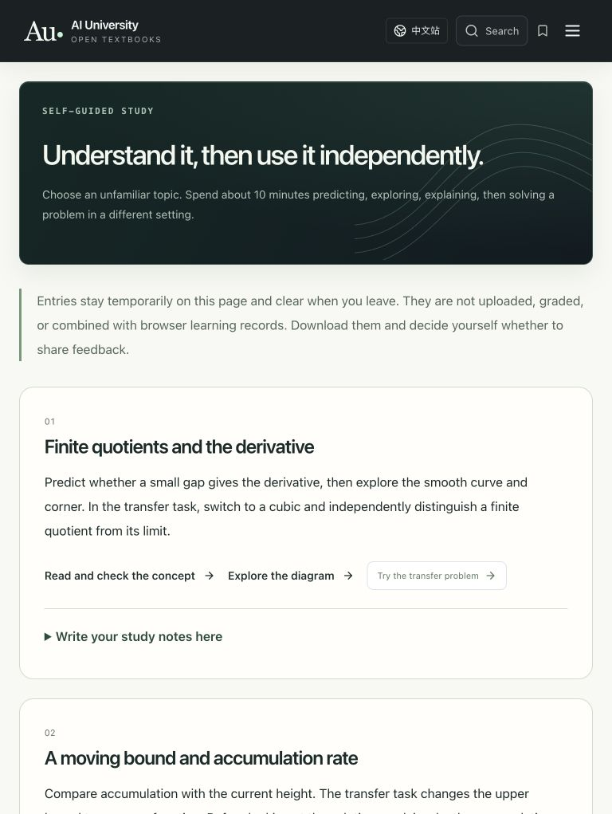

# 误区反馈与迁移任务核对 · 2026-10-27

本轮整卷深化《微积分 I》v0.3.4：35 节、70 条错误选项反馈、35 个观察解释问题，以及 6 道新增迁移题。中英文分别编写并保持数学表达、选项索引、实验参数和题目 ID 一致。其余七卷获得共用预测笔记入口，尚未逐卷补写定向反馈，不能称为全部完成。

## 教学路径与实际检查

1. 中文导数概念题选 A：提示“间隔很小只能给近似”，正确选项未提前高亮；改选 C 后，提示改为区分“有限差商不等于导数”和“导数不存在”，没有复用同一句反馈。
2. 点击 A 的“看对应演示”：实际选中第 2 步，间隔为 0.01，割线斜率读数为 2.01。此路径指向既有真实预设，不是只滚到一个无关图形。
3. 写入预测后切换尖角：预测保留；第 3 步出现解释问题。打开参考解释前不显示解答，也不自动给读者文字评分。仅填写笔记不会误触“参数已修改”。
4. 点击“换个情境再试”：实际进入第 5 题，题干换为三次函数；不是落回第 1 题。英文基本定理同样直接进入移动平方上限的第 5 题。
5. 圆环三维预设加载后，模型为外半径 2、内半径 1，完整截面读数约 9.4248。旋转角度控件的 Home 与恢复预设路径已操作。新增迁移题另改转轴，试学页明确原图不模拟这个新转轴。
6. 试学页使用明确标为“界面验证示例”的文字，实际生成 Markdown 下载；包含主动填写的结果和文字，没有附带学习记录键。没有向 GitHub 提交反馈，也没有实际读者结果。

## 数学独立复算

- 三次函数在 1 的右差商：展开得 $3+3h+h^2$；$h=0.1$ 给 3.31，极限为 3。
- 递减内层复合函数：外层导数乘内层导数，零点结果为 −6；有限差分另作数值核对。
- 平方积分上限：先积分得 $A(x)=x^6/3$ 再求导，得到 $2x^5$；在 −1 为 −2。
- 移动转轴的圆环：外半径 $x+2$、内半径 2，截面积为 $\pi(x^2+4x)$，积分得 $7\pi/3$；中点求积另作核对。
- 单点改值：去心邻域中仍为平方函数，极限为 4，与点值 7 不同。
- 禁止套洛必达的例子：对任意 $M>0$，$0<x<1/(M+1)$ 保证 $1/x>M$，无需非法使用导数比。

## 界面证据

截图中的预测和解释均为本轮界面验证用例，不是真实读者数据。

## 检查范围与限制

`npm run check` 包含 167 项仓库测试、内容与数学排版验证、中英文源校验、独立导出一致性、英语页面渲染及原有数学模型边界检查。新增回归检查覆盖整卷反馈与实验/题目连接、导出文字保留和迁移答案的独立复算。

浏览器检查了中文导数、英文基本定理、圆环三维模型、两种语言的试学页，使用 390×844、768×1024、1280×900。所查页面未见横向文档溢出。没有逐节人工操作全部 35 节，没有执行完整屏幕阅读器审查，也没有测量真实学习效果。

试学流程已准备；真实参与者试学尚未开展。按 [自愿试学流程](../../TRYOUT_PROTOCOL.md) 接收主动反馈后，才能报告实际理解或迁移问题。
